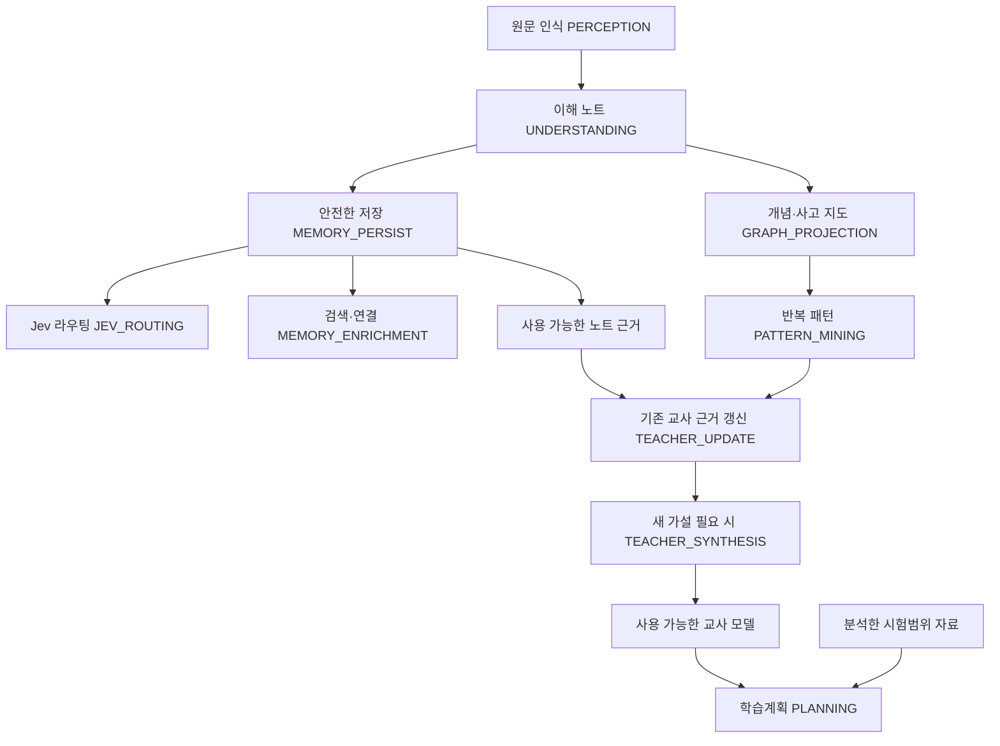

# 후속 분석 실패와 자료 저장을 분리한 변경

이제 이해 노트가 저장되면 그 자료 구간은 성공한 것으로 남습니다. 이후 검색 연결, Jev 판단, 사고 지도, 교사 모델, 계획 중 하나가 실패해도 이미 저장한 노트를 취소하지 않습니다.

## 왜 전체 실패로 보였나

이전에는 웹 작업 하나 안에서 원문 읽기부터 교사 모델까지 순서대로 실행했습니다. 노트 저장 전에도 A-MEM 메타데이터·색인을 실행했기 때문에, 그 연결이 끊기면 원문을 잘 읽고 메모 응답을 받아도 정식 노트 저장에 도달하지 못할 수 있었습니다. 그래프가 실패하면 같은 바깥 예외 처리로 올라가 전체 작업이 실패로 표시됐습니다. [수정 전 코드 조사](resumable_pipeline_mapping.md)에 구체적 위치를 기록했습니다.

## 무엇을 성공으로 저장하나

원문 위치와 정확한 구절을 가진 이해 노트의 본문(MD), 해시·출처(JSON), 자료별 목록을 안전하게 저장한 다음 `MATERIAL_UNDERSTOOD`로 기록합니다. 자료가 여러 구간이면 저장한 구간과 아직 이해하지 못한 구간을 따로 셉니다. 노트 한 개가 있다고 파일 전체를 완료로 표시하지 않습니다.

기본 메모리는 이 저장까지입니다. A-MEM 검색 인덱스·추가 연결은 그 뒤의 별도 작업입니다. 저장한 노트는 검색 엔진이 고장 나도 자료 목록에서 열 수 있습니다.

## 후속 작업은 어떤 순서인가

모든 자료의 검색 연결·그래프 완료를 기다리는 일괄 장벽을 제거했습니다. 확보된 노트는 기존 가설에 연결할 수 있습니다. 다만 노트는 문항 증거와 구분하며, 노트만으로 독립 시험문항 수를 늘리거나 새 가설의 근거를 충족했다고 처리하지 않습니다. 새로운 가설 생성에는 실제로 확보된 문항·반복 패턴이 필요합니다.

## 결과를 어떻게 표시하나

| 결과 | 의미 |
|---|---|
| complete | 해당 작업의 단계 완료 또는 명시적 생략 |
| partial_success | 일부 이해/구조 결과가 저장됐고 남은 단계가 있음 |
| needs_review | 원문·노트·분석을 수동 검토해야 하는 rejected 상태 |
| failed_before_understanding | 이해 노트 저장 전에 실패. 다른 자료의 처리는 계속됨 |

웹에는 **“이해 노트를 저장했어요”**, **“일부 자료의 이해 노트를 저장했어요”**를 구분해 표시합니다. 자료별 ‘처리 상태’를 펼치면 읽기·저장·Jev·지도·교사 갱신 상태를 볼 수 있습니다. 남은 작업은 ‘미완료 분석 재개’로 실행합니다. 부분 성공 알림은 자동으로 숨기지 않습니다. 100MB 업로드 제한·두 자료 공간·원문 검토 기능은 유지했습니다.

계획 생성이 실패하면 기존 결과가 보존됐음을 표시합니다. 이 경우 자료 이해가 새로 완료됐다고 표현하지 않습니다.

## 재개 기록은 어디 있나

교사 자료는 `state/web/workspace/teacher/pipeline_state/tasks/`, 시험범위는 `state/web/workspace/scope/pipeline_state/tasks/`에 JSON 작업 기록을 저장합니다. 각 기록은 stage/source/note/hypothesis/status/시도 횟수/최근 오류/시각/checkpoint/input hash를 갖습니다. 오류 상세는 같은 공간의 `diagnostics/`입니다.

자료·노트·판단 hash가 같은 완료 작업은 다시 호출하지 않습니다. 그래프만 재개할 때는 저장된 원문 snapshot과 이해 노트를 읽으며 OCR·노트 생성을 다시 실행하지 않습니다. 원본이나 검토 텍스트가 바뀌면 오래된 snapshot을 재사용하지 않습니다. 같은 근거 관계·교사 업데이트를 중복 적용하지 않는 기존 ledger도 유지합니다.

API는 기존 `/api/jobs`에서 `action: "resume"`, `target: "teacher"` 또는 `"scope"`, 선택적 `task_ids` 목록으로 실행합니다. 자동 API 재시도·자동 분석 실행은 추가하지 않았습니다. 기존 직접 ingest CLI는 오류를 예외로 보고하는 인터페이스를 유지하며, 저장된 canonical 노트를 보존합니다. 새로운 결과 상태·재개 버튼은 웹 orchestration에 적용했습니다.

## API 낭비는 어떻게 줄였나

메타데이터·태그·주제 문구는 저장한 제목·주제를 복사합니다. 텍스트 근거 지지 판정은 Jev로 옮겼습니다. NVIDIA 네트워크/형식 오류 뒤 다른 모델에 같은 요청을 반복하던 경로를 제거했습니다. 자료가 길어 실패하면 지원되는 구간의 크기를 줄이거나 해당 작업을 대기로 남깁니다. 시간 제한을 늘리지 않았습니다.

[전체 NVIDIA 호출 조사](nvidia_call_audit.md)에 생성이 필요한 곳, 남아 있는 복합 검토, 입력·출력 범위, gate, 캐시, 실패 처리를 모두 정리했습니다.

## 실제 생명과학 PDF 9개의 현재 상태

새 API 호출 없이 기존 원문 인식 결과·노트·체크포인트를 조사했습니다. 파일 이름 순서는 실제 업로드 목록을 따랐습니다.

| 자료 | 읽기 | 저장한 이해 노트 | 이해 완료 | 최종 그래프 |
|---|---|---:|---|---|
| (3) 02. 기관계의 통합적 작용~ | 완료 | 15개 | 승인된 텍스트 범위 완료 | 대기 |
| (4) 01. 생태계의 구조와 기능 | 완료 | 0개 | 미완료 | 대기 |
| (5) 02. 개체군과 군집의 특성-1 | 완료 | 0개 | 미완료 | 대기 |
| (6) 01. 신경자극의 전도와 시냅스 전달 | 완료 | 0개 | 미완료 | 대기 |
| (7) 01. 신경자극의 전도와 시냅스 전달 | 완료 | 0개 | 미완료 | 대기 |
| (8) 02. 신경계의 구조와 기능 | 완료 | 0개 | 미완료 | 대기 |
| 01 생물과 생명과학의 특성 | 완료 | 0개 | 미완료 | 대기 |
| 02생명시스템의 구성단계 | 완료 | 0개 | 미완료 | 대기 |
| 생명과학 중간고사 구조도 | 완료 | 0개 | 미완료 | 대기 |

원본 9개 SHA와 기존 노트·체크포인트 보존을 확인했습니다. **읽기 9/9, 이해 1/9, 노트 15개, 그래프 0/9**입니다. 이미 읽은 사실을 ‘모든 자료 이해 완료’로 바꾸지 않았습니다. 첫 PDF도 OCR 검토 대기 블록이 65곳 있어, 모든 그림이나 과학적 의미의 정확성을 인증한 결과는 아닙니다. 실제 Teacher Model 완성도 아직 확인하지 않았습니다.

과거 웹 오류에는 A-MEM metadata의 네트워크 실패(동일 요청의 두 모델 시도), 최초 understanding timeout, material graph timeout/길이 제한이 있었습니다. 특히 `fe99537a3f3343c9afca18482ffae123.json`의 A-MEM 호출은 이번에 제거한 경로입니다. 다른 프로젝트 진단 중 문항·graph 오류도 남아 있으나 특정 PDF에 직접 귀속할 수 없는 기록은 구분했습니다. [실제 상태·진단 JSON](../output/pipeline_recovery/real_nine_files.json)을 참고하세요.

## 검증 결과

최종 전체 Python 테스트 **176개 통과(94.682초)**, 웹 정적 스크립트·부분 성공 화면 검증 통과. 검증 중 발견한 Jev 결정 종류 스키마와 작업 완료 공개 시점 문제를 수정한 뒤 전체 검증을 재실행했습니다.

수정본은 `http://127.0.0.1:8778/#teacher`에서 실행 중입니다. 기존 8776 서버 종료·재시작이 자동 승인 정책에 의해 차단되어 별도 포트를 사용했습니다. 같은 자료 저장소에서 노트 15개·미완료 단계 33건·100MB 제한을 확인했으며, 분석 작업은 자동 시작하지 않았습니다. [서버 확인 기록](../output/pipeline_recovery/server_verification.json).

전체 Python 테스트는 최종 검증 기록 `output/pipeline_recovery/final-tests.log`에 있습니다. 요청한 A–G(메모리/Jev/graph 실패, 9개 중 일부 실패, 최초 이해 실패, 재개·중복 방지)를 포함합니다. source evidence Jev 판정·캐시·낮은 확신·연결 실패에서도 NVIDIA를 호출하지 않는 검증을 추가했습니다. 웹 스크립트·부분 성공 표시 검증도 실행했습니다. 최종 상태는 자료별 저장을 마친 후 한 번에 공개하도록 수정해, 완료 직후 업로드·다음 작업이 잠깐 막히는 문제도 해결했습니다.

실제 첫 PDF의 노트 15개는 **별도 복사본**에서 다시 실행했습니다. OCR·NVIDIA 이해 생성·Jev 라우팅 호출 0회, 중복 노트 0개, 완료 단계 시도 횟수와 노트 본문 hash 유지가 확인됐습니다. 인덱스는 로컬 모의 객체를 사용했으므로 실제 벡터 엔진 정상 작동을 검증했다는 뜻은 아닙니다. [실제 노트 재개 기록](../output/pipeline_recovery/real_note_replay.json).

1440px·360px 브라우저에서 실제 자료 목록과 부분 성공 알림을 확인했습니다. 알림은 실제 task 데이터를 이용한 화면 모의 상태이며, 새로운 실시간 유료 분석 작업을 완료했다는 뜻이 아닙니다. 펼친 자료 상태의 레이아웃을 수정했고 원본 노트 15개·남은 단계 33건이 표시됐습니다.

## 여전히 실패할 수 있는 조건과 남은 병목

이해 노트가 하나도 저장되지 않은 작업은 실패할 수 있습니다. 저장 공간 부족·권한 오류·원본/노트 hash 손상은 재시도로 덮지 않고 terminal 상태로 기록합니다. 후속 작업의 terminal 오류도 저장된 노트를 지우지 않습니다. 상태 파일 자체를 쓸 수 없는 저장 장치 오류에서는 부분 성공 표시조차 확정할 수 없습니다.

나머지 8개 자료의 이해 생성은 앞으로 실제 API를 실행해야 완료됩니다. 문항 복합 의미 검토·그림 관계 해석·그래프 생성은 여전히 무거운 작업이며 이번 수정만으로 분석 정확도와 속도를 모두 해결한 것은 아닙니다. OCR 검토, 원문 조건·그림 의미 검수, 사용 가능한 교사 모델과 시험범위 확보가 남았습니다. 이번 검증은 저장·실패 분리·재개의 신뢰성을 확인한 작업입니다.
