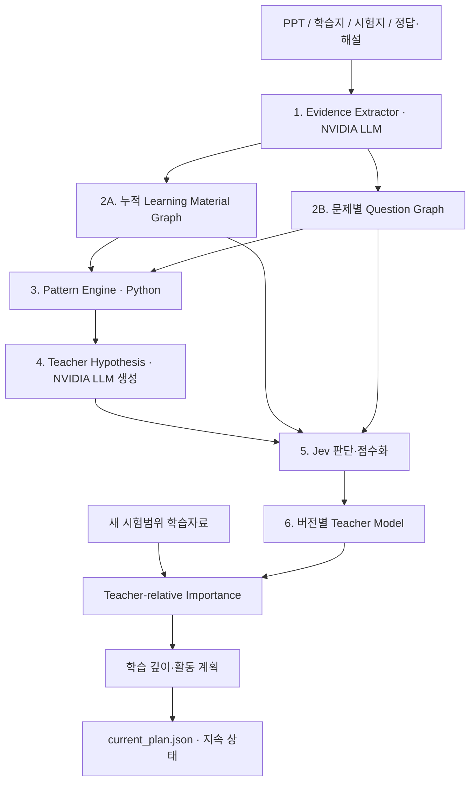

# Backspace Teacher Intelligence Architecture v0.1 — 고정 설계

개발 비중은 Teacher Intelligence 70 / Planning 30. 선생님의 자료와 시험에서 반복되는 개념·사고·평가기준을 추출해 Teacher Model을 유지하고, 그 모델로 새 학습자료의 중요도와 공부계획을 정한다. 로컬 Python 단일 파이프라인과 JSON 상태를 사용한다. 2026-10-06 사용자 지시에 따라 실행 LLM을 GLM에서 이전 NVIDIA Nemotron 구성으로 전환했다. 자료 추출은 Lightning, 문항 분석·의미 검토와 생성적 역할은 Super. 아래의 생성/판단/확정 상태 역할과 구현 순서는 유지한다.

**아키텍처 버전 0.1과 구현 단계 v0.1~v0.7은 서로 다른 번호다.** 기존 패키지 0.2 및 문항·계획 실험 코드는 보존한다. 이전 실험의 `build_teacher_model`(현재 `build_legacy_teacher_report`) 결과는 반복 패턴 보고서이며, 아래의 가설·Jev 점수까지 갖춘 Teacher Model의 완성본이 아니다.

## 역할과 계약

| 담당 | 수행 | 저장하는 결과 |
|---|---|---|
| NVIDIA LLM (Nemotron) | 자료 의미·관계 추출, Question Graph, 출제 의도 후보, Teacher Hypothesis, 계획 자연어 생성 | 관찰 가능한 구조와 원문 근거, 생성 가설 |
| Jev | 가설 지지·반박, 증거 강도, 중요도, 재분석·계획 수정 필요성 판단 | 원 점수·분포·confidence·rubric·모델·입력 해시 |
| Python | ID·그래프 저장, 빈도·반복 구조 계산, 가중치 결합, 버전·계획 상태 변경 | 결정적 통계와 상태 이력 |

생성 LLM이 teacher salience를 임의로 출력하지 않고, Python이 교사의 평가관을 빈도만으로 확정하지 않는다. Jev가 문장·가설을 생성하지 않는다. 자료 관계에 대한 LLM 의미 검토는 Evidence Extractor의 추출 검증이며 교사 성향 판단과 구별한다.

모든 관찰과 판단에는 `source`, `page` 또는 원문 `locator`, `question_id`, `raw_evidence`, `confidence`와 원자료 SHA-256을 보존한다. 학습자료의 `question_id`는 null. 원문 문자열의 위치를 코드로 검증한다. 원문 인용이 맞아도 의미·과학 내용이 맞는지는 별도 검수한다. LLM의 추출 confidence는 자기보고 값으로 보존하며 정답 확률이나 교사 중요도로 사용하지 않는다.

## 그래프와 패턴

Learning Material Graph는 누적 개념과 방향성 관계를 저장한다. 새 문서가 들어오면 공통 Concept ID를 재사용한다. 관계 없는 개념도 개념별 관찰에 포함한다. 문항 전용 개념·사고는 자료 그래프의 출현 빈도를 높이지 않는다.

v0.1 `frequency`의 단위는 **서로 다른 source/page 쌍**이다. 같은 페이지에서 용어가 반복돼도 1, 같은 파일을 재입력해도 증가하지 않는다. `source_count`, `source_types`(ppt/worksheet 등), `source_formats`(pptx/pdf/txt 등), `pages`는 별도로 유지한다. 같은 내용의 복사 파일은 원문 해시 기반 동일 source로 취급한다. 원문이 수정되면 새 source이므로 구판까지 남는다. 구판 제외 정책은 현재 구현하지 않는다.

관계는 from/to/type으로 집계하되 각 assertion의 statement·조건·근거·확신도·검토 결과를 따로 보존한다. 다른 조건의 관계를 무조건 하나의 과학 법칙으로 축약하지 않는다. `explicit_emphasis`는 개념 표기와 중요/핵심/반드시/주의/강조/기억 등 명시적 문구를 함께 담은 원문만 기록한다. 의미 대응은 검수 대상이다. 빈 강조 목록은 `not_observed`이며 중요도 0을 뜻하지 않는다. 색·굵기·그림에서의 강조는 이 단계의 텍스트 추출로 관찰하지 않는다.

Question Graph는 문제마다 Concept → Task/Reasoning → Evidence of Understanding → Assessment Intent 후보를 연결한다. 모든 문항을 강제로 선형 사슬로 만들지 않는다. 답안·수행 과정이 없으면 실제 이해·학생 능력은 `not_observed`. 요구 행동과 관찰된 행동을 구별한다. 정답·해설을 문제와 연결하는 명시적 입력 계약은 v0.2에서 구현한다.

Pattern Engine은 문제 내부의 node/edge/path/subgraph를 Python으로 집계한다. support는 패턴이 관찰된 서로 다른 문제 수이며 분모도 저장한다. 시험별 분포와 원문 근거를 유지한다. 다른 문제를 이어 만든 경로는 반복 패턴이 아니다. 동형 사고 구조와 동일 과학 내용은 구별한다.

## 가설·Jev 점수·Teacher Model

Teacher Hypothesis는 `supporting_evidence`, `counter_evidence`, `applicable_context`, 대안 해석과 추가 확인 자료를 포함한다. 출제 의도와 평가관은 조건부 가설이며 교사의 성격·사적 의도를 확정하지 않는다.

Jev에는 좁게 분리한 판단 질문을 보낸다. Recurrence / Source Diversity / Exam Relevance / Reasoning Centrality / Explicit Emphasis / Evidence Quality / 가설 지지·반박을 독립 항목으로 다룬다. 빈도와 분모는 Python이 계산하고 Jev에 원 통계와 근거를 제공한다. Score 값과 confidence, 각 level의 probabilities, 기준표를 모두 저장한다. Python은 버전이 명시된 가중치로 요약 salience를 계산하며 원 점수를 버리지 않는다. 평가할 근거가 없는 차원은 null/미관찰 상태를 유지한다. 사용자 예시의 .87이나 .89는 실제 결과로 저장하지 않는다.

Teacher Model은 concept importance, dominant reasoning, assessment ideals, 적용 범위, 근거·반례, 모델 및 데이터 버전을 가진다. 갱신할 때 이전 버전과 입력 해시를 보존한다. 새로운 관찰이 기존 가설을 약화시키거나 반박할 수도 있다.

## Planning 30

새 시험범위 자료를 별도의 Concept Graph로 추출한 후 기존 Teacher Model과 연결해 Jev가 teacher-relative importance를 판단한다. Planner는 그 점수로 공부 깊이와 문항 적용·조건 변화·기본 이해·빠른 확인 활동을 정하고 NVIDIA LLM이 근거를 반영한 자연어 계획을 작성한다.

초기 Study Priority ≈ Teacher Importance. 이후 Student Weakness × Exam Relevance × Forgetting을 추가한다. 개인 데이터가 없는 상태에서 임의의 약점·망각 점수를 채우지 않는다. Plan은 진행 상태와 이력을 저장하고 내용·근거가 바뀐 활동의 완료 상태를 자동 유지하지 않는다.

## 구현 순서와 완료 기준

| 구현 단계 | 산출물 | 이번 상태 / 통과 기준 |
|---|---|---|
| v0.1 | 자료 → 누적 Concept Graph | 개념별 근거, 관계 조건, 빈도 단위, 반복 입력, 버전 이력, JSON 검증 |
| v0.2 | 시험문제 → Question Graph | 구현: Task/이해 증거/정답·해설 계약, 문항별 JSON·근거·갱신 이력; 합성 2문항 실제 NVIDIA 실행 및 구조 테스트 검증. 실제 시험 정확도 benchmark는 미실시 |
| v0.3 | 반복 Pattern | 새 Pattern Engine의 node/edge/path/subgraph·분모·문항 근거·버전 코드 작성. 실행·테스트는 사용자 요청에 따라 v0.7 이후로 유보 |
| v0.4 | Teacher Hypothesis | 가설 생성·지지/반례·범위·대안·추가 자료·문맥 선택·버전 코드 작성. 실행·테스트·API 호출은 v0.7 이후로 유보 |
| v0.5 | Jev scoring | TypeSafe HTTP·가설/근거/개념 차원별 판단·원 분포·가중 요약·버전 코드 작성. 실행·테스트·인증된 API 호출은 v0.7 이후로 유보 |
| v0.6 | Teacher Model | 개념 중요도·반복 사고·평가관 후보·원 점수/근거·갱신 이력 코드 작성. 실행·테스트는 v0.7 이후로 유보 |
| v0.7 | 새 자료 + Teacher Model → Plan | 상대 중요도·활동·시간 예산·현재 상태/이벤트/이력·오프라인 코드 작성. 실행·테스트는 다음 통합 검증으로 유보 |

이 순서 이후에는 기능 확장보다 실패 분석 → 수정 → benchmark를 우선한다. 단위 테스트는 출처·상태 처리 검증이며 실제 시험의 해석 정확도를 보증하지 않는다.

2026-10-06 사용자 요청으로 v0.3~v0.7은 제작만 진행한다. 단계별 실행·테스트·API 품질 실험을 생략하고 v0.7 제작 후 통합 검증한다. [구현 상태](implementation_status.md)에 제작과 검증 여부를 구별해 기록한다.

## 지속 상태

`dataset.json`은 재생 가능한 원문·개념 관찰·관계의 내부 상태이다. `material_graph.json`은 그 자료 부분만으로 결정적으로 계산한 누적 그래프이며 자동 내보내기를 제공한다. 그래프 내용이 바뀌면 revision 증가와 `material_graph_history/` 보관. 원문 재분석은 명시적 `--refresh` 후 모든 단계가 성공한 경우에만 교체한다. 이전 자료는 근거 관찰/강조/confidence를 소급 생성하지 않고 `needs_reextraction`으로 표시한다.

v0.2는 `question_graphs/q*.json`과 활성 문항 `index.json`을 저장한다. 나머지 후속 단계의 고정 파일명은 `teacher_hypotheses.json`, `teacher_model.json`, `current_plan.json`, `usage_log.json`. 현재 `usage_log.json`은 실제 NVIDIA 호출의 단계·모델·상태·시간·usage를 보존하며 키·헤더·프롬프트는 제외한다. 비용을 측정하지 못했으면 null이며 0으로 추정하지 않는다. 캐시 재사용은 체크포인트 manifest에서 확인한다.

v0.3의 `mine_patterns`는 `patterns.json`과 변경 이력 `pattern_history/`를 저장하도록 구현했다. 통계는 활성 Question Graph snapshot에서 다시 계산한다. 자료 그래프와 문항 파일을 수정하지 않는다. 새로운 Teacher Model 생성은 후속 v0.6에 연결한다.

v0.4의 `build_teacher_hypotheses`는 `teacher_hypotheses.json`과 `teacher_hypothesis_history/`를 저장하도록 구현했다. 반복 통계와 생성 해석을 구별하며 confidence는 null, 점수화는 pending_jev다. 반례 검색은 기록된 제공 문맥 안으로 제한한다.

v0.5의 `score_teacher`는 별도 `teacher_scores.json`과 `teacher_score_history/`를 저장하도록 구현했다. Jev의 원 score·legend·분포·confidence와 Python의 가중 요약을 구별한다. 미관찰 차원은 null로 보존한다. 실제 API 호환성·판단 품질은 아직 검증하지 않았다.

v0.6의 `build_teacher_model`은 새 구조의 `teacher_model.json`과 `teacher_model_history/`를 저장하도록 구현했다. 원 관찰·가설·Jev 판단을 연결하고 미점수화 항목을 null로 유지한다. 과거 모델은 이력에 보관하고 신규 관찰에 과거 점수를 자동 이월하지 않는다. 이전 실험 보고서는 `build_legacy_teacher_report`로 구별한다.

v0.7의 `generate_plan`은 새 범위 자료와 모델을 연결해 `current_plan.json`을 저장하고 `update_plan`으로 진행/대화/추가 메모를 유지하도록 구현했다. 온라인 상대 중요도는 Jev, 활동 생성은 NVIDIA, 시간/상태는 Python이 담당한다. `--offline`은 기존 동일 개념 중요도와 템플릿만 사용한다. 이전 실험 계획은 `generate_legacy_plan`으로 구별한다.

저장 파일 각각은 atomic replacement를 사용한다. dataset이 기준 상태이고 그래프는 파생 상태이다. 중단 후 내보내기가 누락되면 `export_material_graph` 또는 `export_question_graphs`로 복구한다. 복잡한 DB, 멀티에이전트, UI는 추가하지 않는다.

## 공식 서비스 계약과 참고 링크

2026-10-06 확인. Jev 키는 원본 `jev.txt`에서 로컬 `.env`의 `TYPESAFE_API_KEY`로 옮겨 사용 준비했으며 원본 파일은 보존한다. 현재 v0.1은 Jev 호출을 하지 않는다.

- [TypeSafe 공식 Jev 발표](https://typesafe.ai/blog/introducing-system-one-models-and-jev): 구조화된 확률 판단 모델의 역할과 회사 자체 평가의 범위. 타입 일치 보장은 과학적 판단 정확도 보장과 구별한다.
- [TypeSafe Introduction](https://docs.typesafe.ai/introduction): Choice/Score/Noul, 같은 state에 대한 독립 질문, Python으로 결과 결합.
- [TypeSafe Quick start](https://docs.typesafe.ai/introduction/quickstart): `POST https://api.typesafe.ai/v1/systemone`, `Authorization: Bearer`, state/model/questions, 기본 `jev-latest`.
- [TypeSafe Score](https://docs.typesafe.ai/primitives/score): 기준표의 위치 점수와 분포·confidence를 따로 보존. 분수 점수도 가능하며 0~1 확률과 동일한 개념이 아니다.
- [jev-ultrafast](https://github.com/browser-use/jev-ultrafast): 브라우저 의사결정 응용 참고. Backspace의 점수화 어댑터는 공식 서비스 계약을 사용하며 이 브라우저 에이전트를 설치하지 않는다.
- [NVIDIA GLM Build](https://build.nvidia.com/z-ai/glm-5-3-flash?section=deploy): 모델 식별자 `z-ai/glm-5.3-flash`, NVIDIA API 키와 chat completions endpoint.
- [NVIDIA GLM reference](https://docs.api.nvidia.com/nim/reference/z-ai-glm-5-3-flash): low/high/max reasoning effort, 추론과 답의 별도 반환. GLM을 다시 선택할 때 사용할 계약이며 현재 실행 모델은 Nemotron이다.

사용자가 제공한 digitalmarketer/tistory 글도 참고했고 Velog 페이지는 열리지 않았다. 실제 연결 형식과 반환값은 위 공식 문서를 기준으로 한다.
